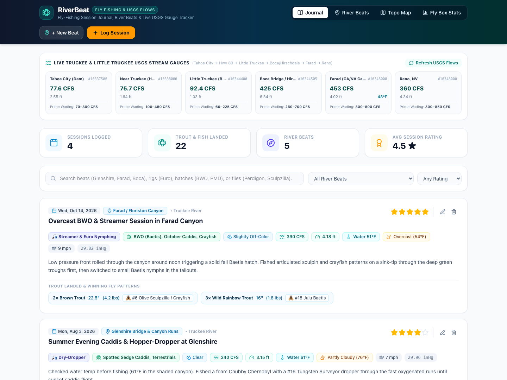
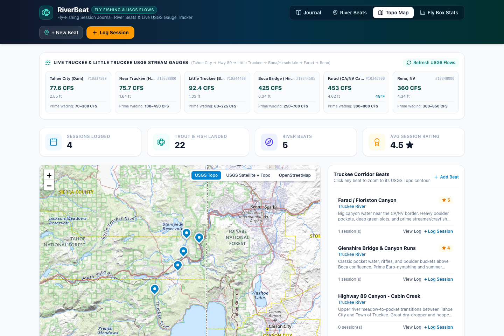

# RiverBeat

A modern full-stack TypeScript fly-fishing journal, river beat directory, and live/historical USGS stream gauge tracker — pre-configured for the **Truckee River & Little Truckee watershed** and surrounding Sierra waters.





## Features

- **Live Truckee Watershed USGS Flow Dashboard**:
  - Real-time discharge (**CFS**), gauge height (**ft**), water temperature (**°F**), and prime wadeable flow ranges across the 6 key Truckee & Little Truckee USGS stream gauges:
    - `10337500` — **Tahoe City (Dam)** *(Prime wading: 70–300 CFS)*
    - `10338000` — **Near Truckee (Hwy 89)** *(Prime wading: 100–450 CFS)*
    - `10344400` — **Little Truckee above Boca** *(Prime wading: 60–225 CFS)*
    - `10344505` — **Boca Bridge / Hirschdale** *(Prime wading: 250–700 CFS)*
    - `10346000` — **Farad Canyon (CA/NV Border)** *(Prime wading: 300–800 CFS)*
    - `10348000` — **Reno, NV** *(Prime wading: 300–850 CFS)*
- **Fly-Fishing Session Journal**:
  - Track your **Primary Rig / Technique** (*Euro / Tight-Line Nymphing*, *Indicator Nymphing*, *Dry-Dropper*, *Technical Dry Fly*, *Streamer*, *Swinging Soft Hackles*).
  - Record **Active Hatches Observed** (*BWO / Baetis*, *PMD*, *Golden Stones*, *Skwala*, *Green Drakes*, *Spotted Sedge Caddis*, *October Caddis*, *Crayfish / Sculpin*, *Midges*, *Terrestrials*).
  - Track **Water Clarity** and automatic **Hoot Owl Thermal Stress Alerts** when water temperatures reach **≥ 67°F**.
  - One-click **Auto-Fill from USGS & Weather**: automatically populates historical or live USGS river flow, gauge height, and water temperature alongside Open-Meteo sky condition, air temperature, wind speed, and barometric pressure (`inHg`) for the session date and location.
- **Trout & Fly Pattern Logging**:
  - Record species (*Wild Rainbow Trout*, *Brown Trout*, *Mountain Whitefish*, *Brook Trout*, *Lahontan Cutthroat Trout*), count, max length (`in`), weight (`lbs`), and winning fly pattern per session.
  - Upload and view session photos in a built-in lightbox gallery.
  - **Fly Box Stats**: View your top-producing fly patterns, catch totals by rig/technique, and personal bests by species.
- **USGS Topo & Satellite Map Explorer**:
  - Interactive Leaflet map with **USGS Topo**, **USGS Satellite + Topo**, and **OpenStreetMap** tile layers (no API keys required).
  - Click anywhere on the map or drag the pin to set coordinates for a new river beat, and discover nearby active USGS stream gauges in one click.
- **Google Sign-In & Email Allowlist**:
  - Zero-config local development (`localhost` bypasses login when `GOOGLE_CLIENT_ID` is unset).
  - Production deployments use Google Identity Services (`GOOGLE_CLIENT_ID`) and optional `ALLOWED_EMAILS` allowlisting so only authorized Google accounts can access your logbook.

---

## Tech Stack

- **Frontend**: React 19, TypeScript, Vite, Tailwind CSS v4, Leaflet (USGS National Map Topo & Imagery tiles), Lucide Icons
- **Backend**: Node.js (`node:sqlite` built-in `DatabaseSync`), Express 5, Multer (image uploads), `node:crypto` (HMAC-SHA256 session tokens & Google ID token verification)
- **External Data APIs**:
  - [USGS Water Services (`waterservices.usgs.gov`)](https://waterservices.usgs.gov/) — Live instantaneous (`iv`) and historical daily (`dv`) river discharge (`00060`), gauge height (`00065`), and water temperature (`00010`)
  - [Open-Meteo Forecast & Historical Archive API](https://open-meteo.com/) — Historical & current weather, wind speed, and barometric pressure

---

## Getting Started Locally

> **Prerequisites**: Node.js **22.5+** (for built-in `node:sqlite`).

```bash
git clone https://github.com/johnksterling/riverbeat.git
cd riverbeat

npm install
npm run dev
```

Open **http://localhost:5173** in your browser.

### Available Scripts

| Command | Description |
| :--- | :--- |
| `npm run dev` | Start both the Express API server (`http://localhost:3001`) and Vite frontend (`http://localhost:5173`) |
| `npm test` | Run backend API, SQLite, and authentication test suite via Vitest |
| `npm run build` | Run strict TypeScript check (`tsc -b`) and build the production bundle (`dist/`) |
| `npm start` | Run the production server (`NODE_ENV=production`) |

---

## Deploying to Google Cloud Run

RiverBeat includes a [`Dockerfile`](./Dockerfile) and [`deploy-cloudrun.sh`](./deploy-cloudrun.sh) script that provisions a Google Cloud Storage bucket (`gs://<project-id>-riverbeat-data`) and mounts it at `/app/data` so your SQLite database (`riverbeat.db`) and uploaded session photos (`uploads/`) persist across container restarts.

1. **Create a Google OAuth 2.0 Web Client ID**:
   - Visit **[Google Cloud Console → Credentials](https://console.cloud.google.com/apis/credentials)**.
   - Click **Create Credentials → OAuth client ID → Web application**.
   - Add your Cloud Run `.run.app` URL under **Authorized JavaScript origins** (no trailing slash).

2. **Deploy with [`deploy-cloudrun.sh`](./deploy-cloudrun.sh)**:
   ```bash
   GOOGLE_CLIENT_ID="your-client-id.apps.googleusercontent.com" \
   ALLOWED_EMAILS="your.email@gmail.com" \
   ./deploy-cloudrun.sh
   ```

### Environment Variables

| Variable | Default | Description |
| :--- | :--- | :--- |
| `PORT` | `3001` (`8080` in Docker) | HTTP port for the Express server |
| `DATA_DIR` | `./data` | Directory where `riverbeat.db` and `uploads/` are stored |
| `GOOGLE_CLIENT_ID` | *(unset)* | Google OAuth 2.0 Web Client ID. When unset, auth is bypassed for local dev |
| `ALLOWED_EMAILS` | *(unset)* | Comma-separated list of Google email addresses allowed to sign in |
| `AUTH_SECRET` | *(auto-derived)* | Optional secret key for signing 30-day session tokens |
